# IceHrm - v36.1

**Release Date:** November 2026
**Version:** 36.1.0

IceHrm v36.1 changes where everyone starts their day. A new **Home** page brings each
person's tasks, team and company news together in one place, with a company feed, kudos
and direct messages built in. New companies get a guided **Company Onboarding** setup,
new hires get a **New Hire Onboarding** checklist, and the employee record gains the
fields HR teams most often asked for, including work history, salary history and bank
accounts.

---

## Table of Contents

1. [Home](#home)
2. [Kudos](#kudos)
3. [Channels and Inbox](#channels-and-inbox)
4. [Company Onboarding](#company-onboarding)
5. [New Hire Onboarding](#new-hire-onboarding)
6. [Richer Employee Records](#richer-employee-records)
7. [Safer Invitations](#safer-invitations)
8. [Other Improvements](#other-improvements)
9. [Bug Fixes](#bug-fixes)
10. [Upgrade Notes](#upgrade-notes)

---

## Home

Home is now the first screen for every user level. It does three jobs: shows what is
happening and what needs you, puts the most common actions one click away, and takes you
to the rest of the application.

- **Quick actions** - Request time off, clock in and give kudos from the welcome banner
- **Pending tasks from every module** - Approvals, check-in reminders, setup items and
  onboarding steps in one list, each linking to where it is resolved
- **Company feed** - Posts and kudos from across the company, with reactions and comments
- **My team** - Your manager, peers and direct reports, or your teams when the Team
  extension is installed
- **Upcoming time off, birthdays and work anniversaries**

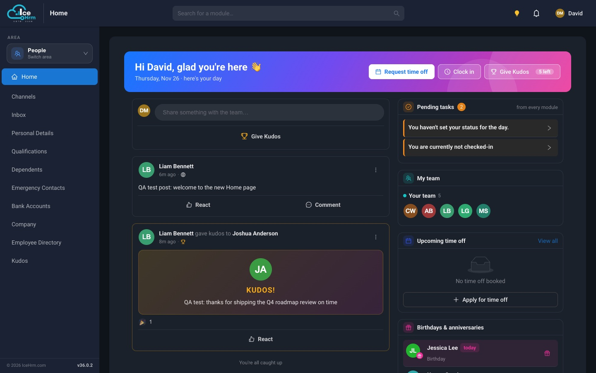

Administrators also see a setup banner that tracks Company Onboarding progress until the
company is set up.

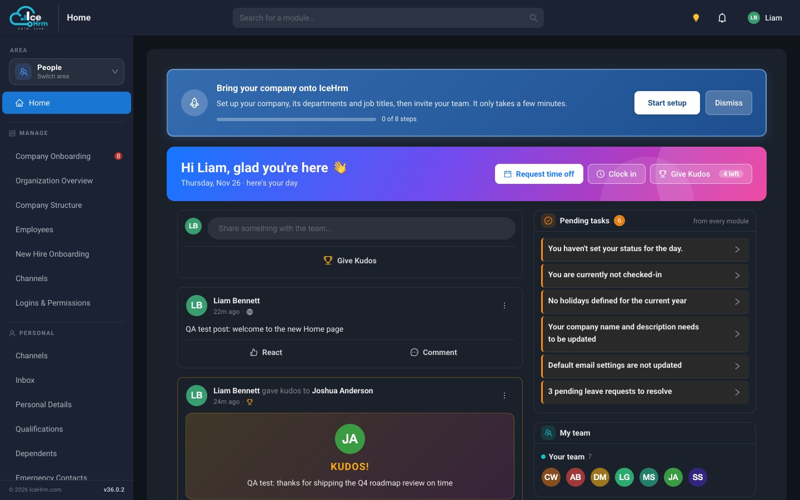

The existing dashboards are still available. Home only takes over the landing page.

---

## Kudos

Recognise a colleague in a few seconds.

- **Give kudos** to one person, with a message, an optional company value and an optional
  image
- **Choose who sees it** - Everyone, your department, or your team (manager, peers and
  direct reports). The giver and the recipient always see their own kudos
- **Monthly allowance** - Five kudos per person per month by default. Change it (2 to 10)
  with the **Kudos: Max Kudos Per Month** setting
- **Feed, Received and Given** views, plus kudos cards on Home
- **Emoji reactions** - 👍 🎉 ❤️ 👏 🔥 💯

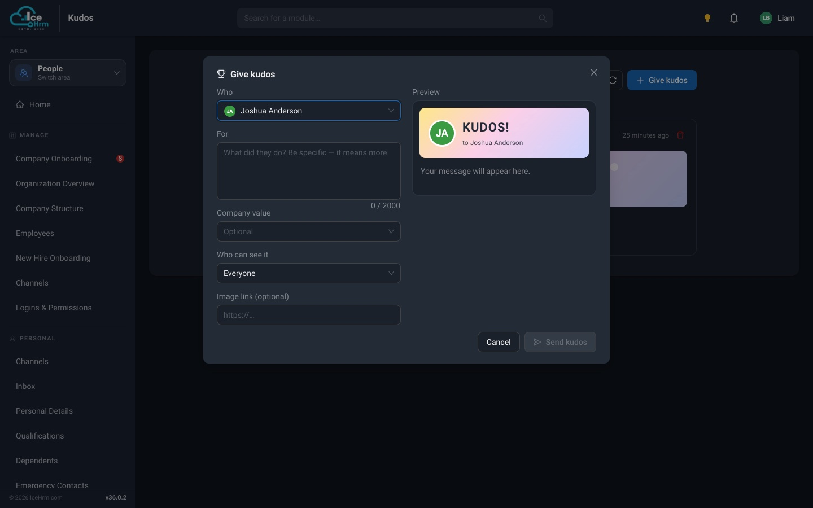

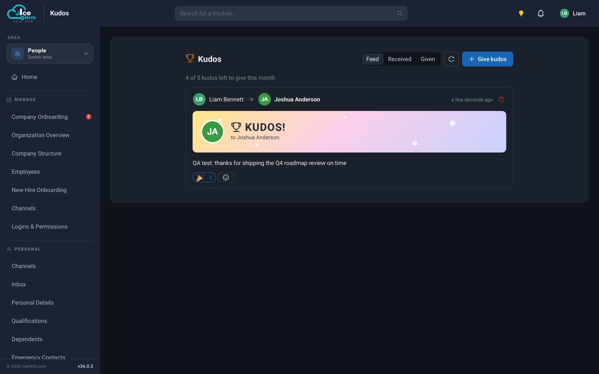

---

## Channels and Inbox

### Channels

Company discussions with per-channel permissions. Each channel decides which user levels
can read, post and reply. Two channels are built in: **Announcements** (everyone reads,
only administrators post) and **Public** (the company feed shown on Home).

- Rich posts with attachments, two levels of replies, and reactions
- **@mentions** of colleagues, always shown with the person's current name
- Administrators manage channels and their permissions from **Manage → Channels**

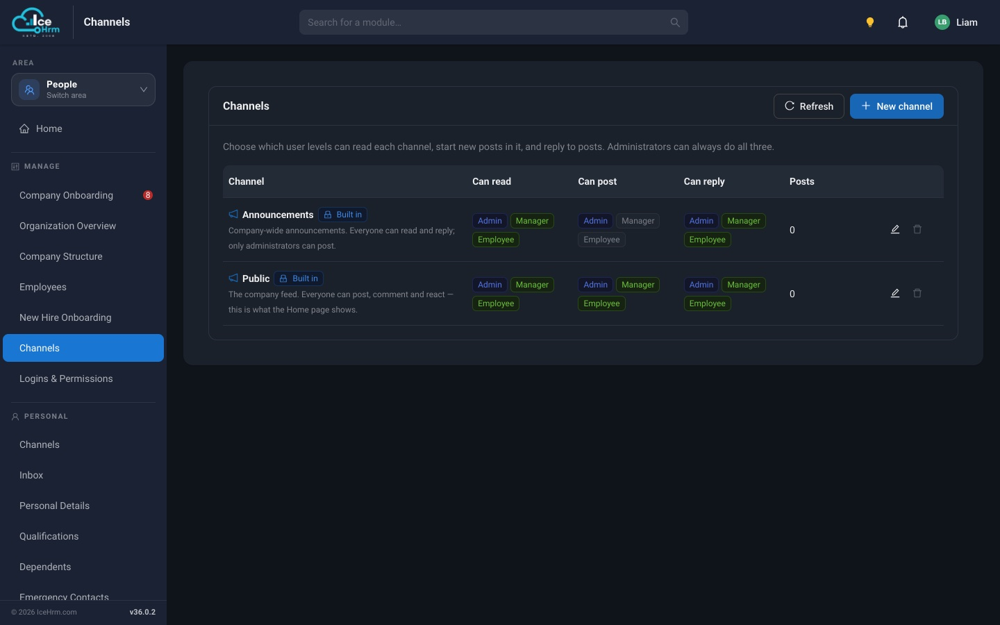

### Inbox

Private direct messages between two employees. Find a colleague and start a conversation.
Only the two participants can read it, whatever their user level.

---

## Company Onboarding

A step-by-step setup that takes a new company from sample data to a working installation:

1. **Start clean** - Remove the sample data
2. **Company details** (required)
3. **Offices and departments**
4. **Job titles**
5. **Employment types**
6. **Work week and holidays**
7. **Leave types**
8. **Invite your team** (required) - Add people one row at a time or paste them from a
   spreadsheet, pick an onboarding workflow and send the invitations

Optional steps can be skipped and finished later. Progress shows on Home and in the menu
badge.

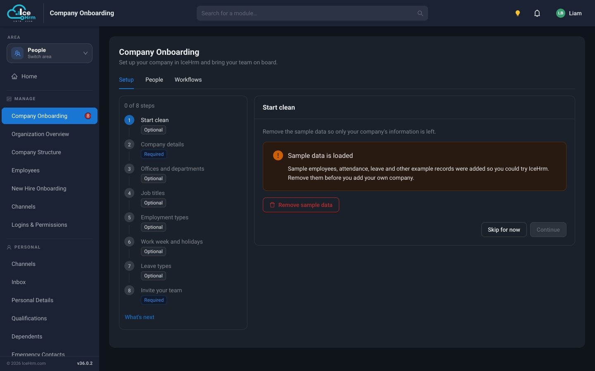

**Invite an Employee** on the Employees screen now opens the **Invite your team** step
directly.

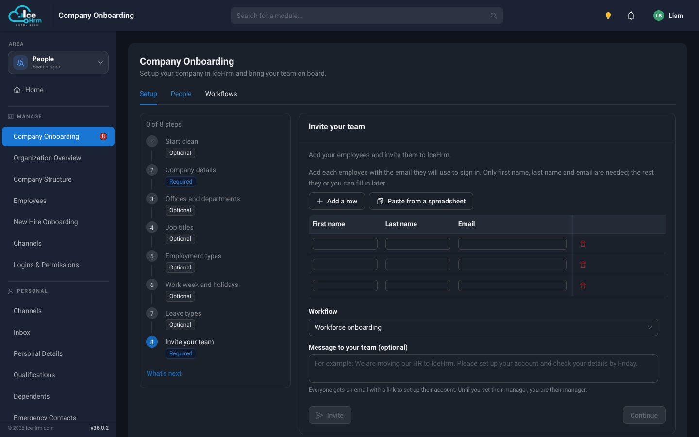

---

## New Hire Onboarding

Invite a new hire with a workflow, and everyone involved gets their part of the checklist.

- **Ready-made workflows** - Standard office hire, Remote hire, Engineering hire,
  Contractor, Financial services (regulated) hire, and Workforce onboarding. Use them as
  they are or copy one to customise it
- **Before and after the start date** - The new hire sets their own password, then works
  through information pages, acknowledgements and document uploads
- **Tasks for HR, IT, the manager and a buddy**, each shown under **My onboarding tasks**
  and on Home
- **Document review** - HR approves uploaded documents or asks for changes
- **Connected steps** - Forms, e-signature, courses and company assets, when those
  extensions are installed
- **Automatic activation** - The new hire's status is *Onboarding* until their start date,
  then they become *Active* with full access to the application, directory, payroll and
  leave
- **My Onboarding** - The new hire's own checklist

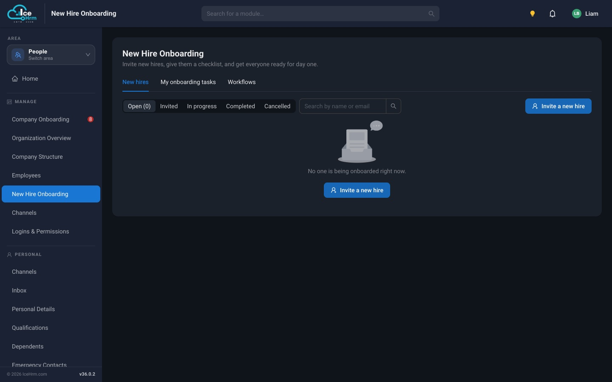

---

## Richer Employee Records

### New employee fields

- **Employment**: employment type, work location, work mode, cost center, contract end
  date, weekly hours, FTE and original hire date
- **Offboarding**: last working day, termination type and reason, eligible for rehire,
  and regrettable leaver
- **Personal**: about, and LinkedIn profile
- New lists for **work locations**, **cost centers** and **termination reasons** (common
  reasons are included)
- New company setting: **Standard Weekly Hours**

### Work History

Each change of job title, department, manager, pay grade, location or employment type is
kept with its start and end dates and a reason, on a new **Work History** tab.

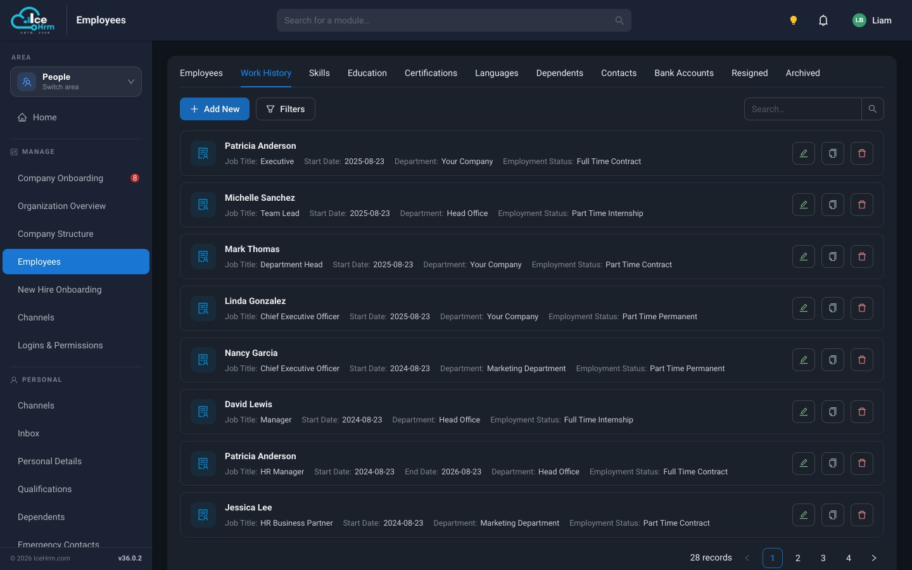

### Salary History

Salary changes are now recorded over time instead of only the current figures.

### Bank Accounts

Employees can have several bank accounts, with a primary account and an optional salary
split (percentage, fixed amount or remainder). **Account numbers and IBANs are stored
encrypted**, and employees see only the last four characters of their own accounts.

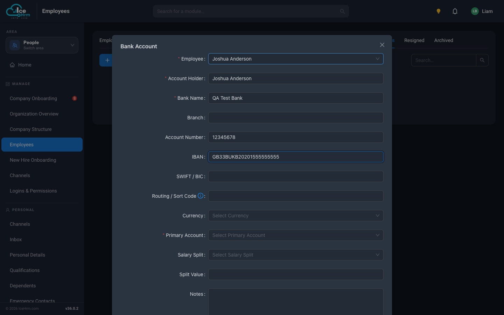

### Emergency contacts and dependents

Emergency contacts gain email, address and a primary contact flag, with longer phone
numbers. Dependents gain gender and more relationship types.

---

## Safer Invitations

- **No passwords in email** - Invitations carry a single-use link and the invitee chooses
  their own password
- **Links expire** - Invitation links are valid for a limited number of days
- **Logins & Permissions** - The *Users* menu is renamed to make clear that a user is an
  employee's login

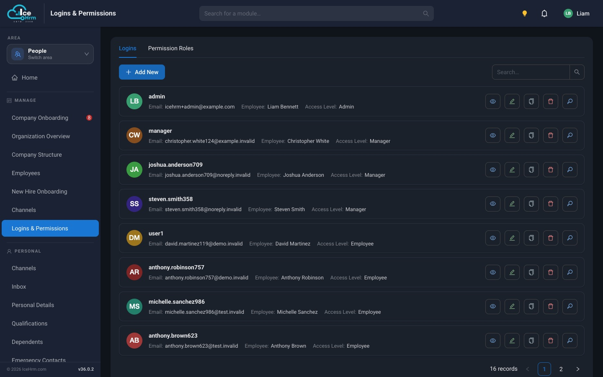

---

## Other Improvements

- All system emails now share one consistent layout
- Shared translation support for every bundle, including the new screens
- Profile sections open their edit form on the relevant step
- Extensions can show banners with progress and actions on Home and the dashboards (used
  by the Company Onboarding setup banner)

---

## Bug Fixes

- The release package now includes the root `index.php`, so opening the site root
  redirects to the application again on non-Docker installations

---

## Upgrade Notes

### Database Migrations

Migrations run automatically the next time anyone signs in. This release:

- Adds the new employee fields and lists, bank accounts and salary history
- Creates one open **Work History** entry for each active employee that has none, and
  fills **Salary History** from current salaries
- Makes the employee **time zone** required. Employees without one get the time zone of
  their department, or the nearest parent structure that has one, which is the time zone
  they were already treated as being in
- Adds the *Onboarding* employee status
- Renames the **Users** menu to **Logins & Permissions** (unless you renamed it yourself)

### Pending invitations

Invitation links sent before the upgrade keep working, and expire 14 days after the
upgrade.

### New extensions

Kudos, Channels, Inbox, Company Onboarding and New Hire Onboarding are installed with this
release.

### Requirements

No change. IceHrm v36.1 runs on the same PHP and MySQL versions as v36.0.

### Breaking Changes

None.
