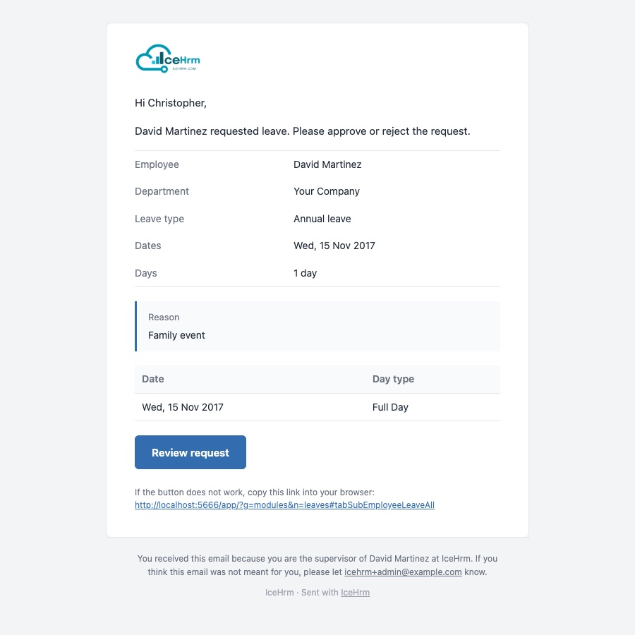
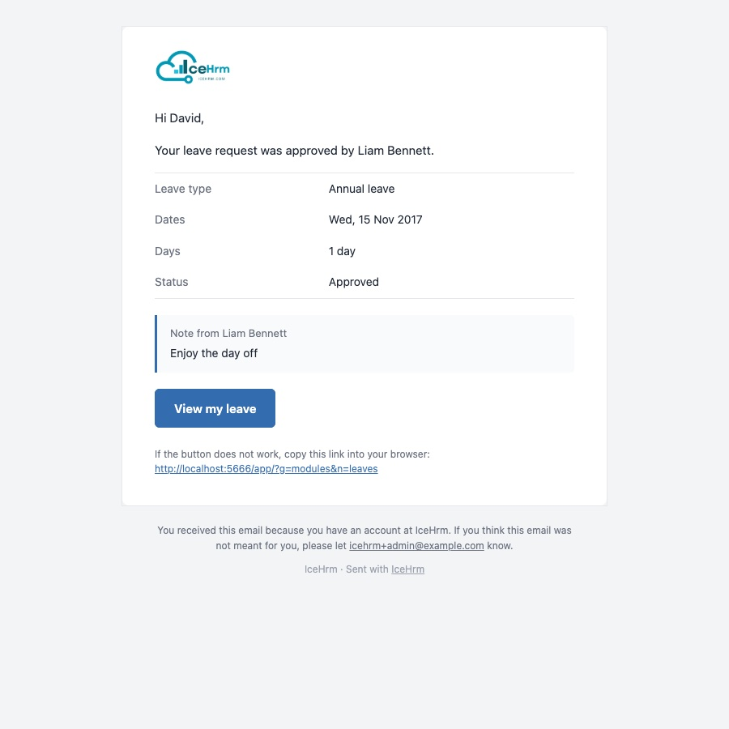

# IceHrm - v36.1.1

**Release Date:** November 2026
**Version:** 36.1.1

IceHrm v36.1.1 is a maintenance release for v36.1. Leave emails now use the same clear,
professional layout as the other system emails, managers are told about leave requests even
when the employee only has indirect supervisors, and **Attendance** is back in the
**Manage** menu for administrators.

---

## Table of Contents

1. [Leave Emails](#leave-emails)
2. [Bug Fixes](#bug-fixes)
3. [Upgrade Notes](#upgrade-notes)

---

## Leave Emails

Every leave email now uses the shared IceHrm email layout introduced in v36.1. The emails show
your company logo, explain why the reader got them, and link straight to the right screen.

- **Leave request** - The approver sees who is asking, their department, the leave type,
  dates, number of days, the reason, and a day-by-day breakdown, with a **Review request**
  button
- **Cancellation request** - The same details when an employee asks to cancel leave that
  was already approved
- **Request submitted** - The employee gets a confirmation that their request was sent for
  approval
- **Status changed** - The employee is told whether the request was approved, rejected or
  cancelled, by whom, and any note the reviewer added, with a **View my leave** button
- **One email, whoever reviews** - Changing a leave's status from the administrator's leave
  screen now sends the same email as a manager approving it, including the reviewer's note
- **Clearer notifications** - In-app notifications use the same wording, for example
  *"David Martinez applied for leave on 13 Nov 2017."* or *"Your leave request was approved
  by Liam Bennett. Note: Enjoy the day"*

---

## Bug Fixes

- **Attendance missing from the Manage menu** - In v36.1.0, **New Hire Onboarding** took the
  menu position of **Attendance**, so administrators no longer saw Attendance under
  **Manage**. Both now show. Any two modules that share a menu position are now both kept
- **Leave requests without a direct supervisor** - When an employee had no direct supervisor,
  no leave request email was sent, not even to their indirect supervisors. Indirect
  supervisors who can approve leave are now emailed
- **Empty leave notifications** - Setting a leave back to *Pending* no longer adds an empty
  notification for the employee

---

## Upgrade Notes

### Database Migrations

None.

### Email templates

The leave email templates (`leaveApplied.html`, `leaveCancelled.html`,
`leaveStatusChanged.html` and `leaveSubmittedForReview.html`) are removed. The emails are now
built in code. If you edited these files, those edits no longer apply.

### Requirements

No change. IceHrm v36.1.1 runs on the same PHP and MySQL versions as v36.1.0.

### Breaking Changes

None.
